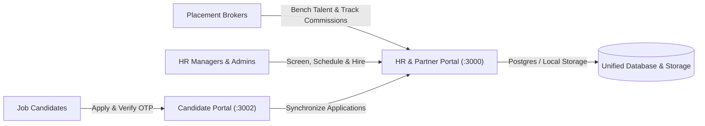
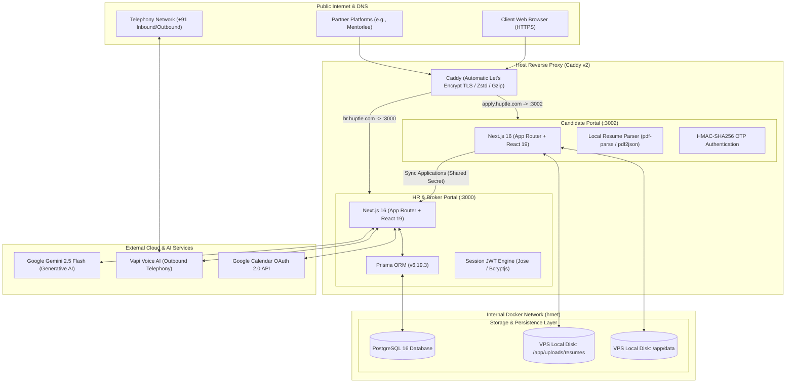
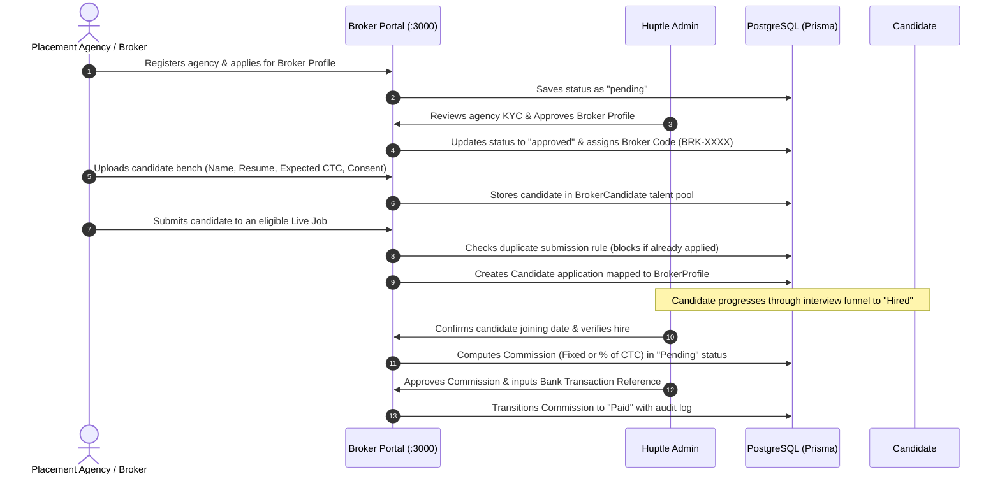
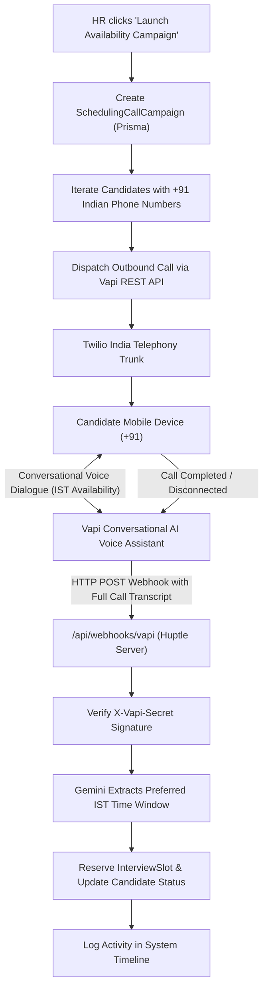
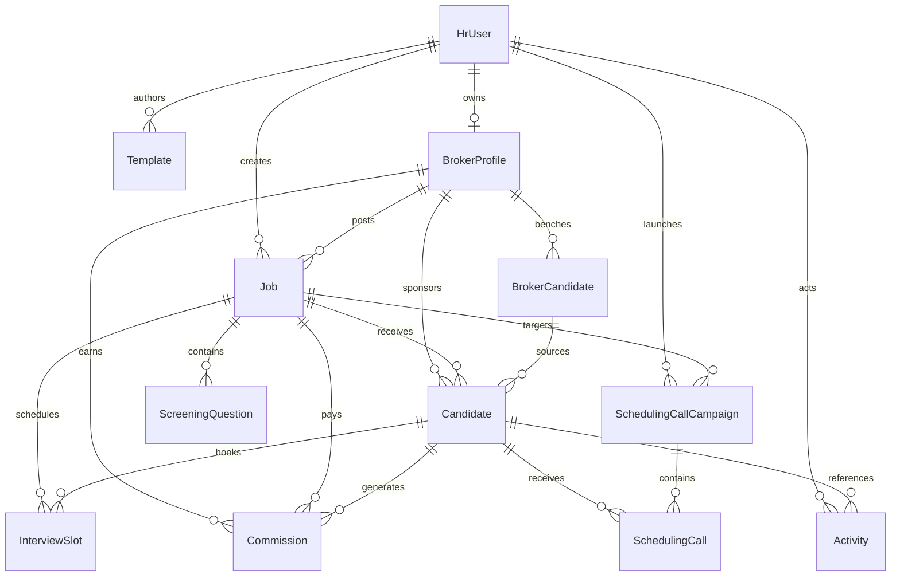
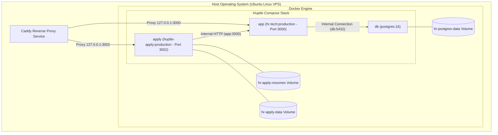
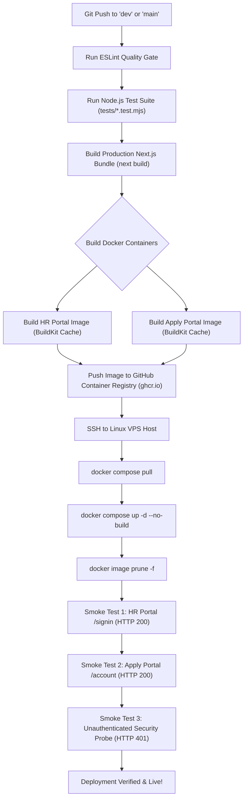

# Huptle HR Tech Platform: Complete System Architecture & Technical Specification

> **Created by: Aaryan Gupta**  
> **Document Version:** 1.0.0 (Production Architecture)  
> **Date:** November 2026  
> **Classification:** Technical Documentation & Architectural Reference  

---

## 1. Executive Summary & Platform Overview

**Huptle HR** is an enterprise-grade, AI-native **Talent Acquisition and Placement Ecosystem**. The platform bridges three distinct hiring stakeholders into a high-throughput, automated pipeline:

1. **HR Managers & Recruiters**: Manage open positions, track applicants across custom recruitment funnels, deploy AI-assisted candidate screening, conduct outbound voice interview scheduling via telephony, and oversee agency placements.
2. **Placement Brokers / Agency Partners**: Independent recruitment agencies and headhunters who maintain private talent benches, submit candidates to approved jobs with consent tracking, monitor recruitment funnels, and earn verified placement commissions.
3. **Candidates & Job Seekers**: Direct applicants who discover open positions, leverage AI to match their profiles, upload and parse resumes, authenticate securely via passwordless email OTP, and track application milestones in real-time.

---

## 2. Global System Topology & High-Level Architecture

The platform is architected as an interconnected **multi-service containerized architecture** deployed on Linux VPS infrastructure behind a high-performance **Caddy** reverse proxy.

---

## 3. Core Software Subsystems

### 3.1 HR & Placement Partner Portal (`/src` - Port 3000)

The primary operational dashboard used by HR teams and agency recruiters.

* **Technology Foundation**: Built on **Next.js 16.2.1**, **React 19.2.4**, **Tailwind CSS v4**, and **Framer Motion 12**.
* **Authentication Architecture**:
  * Employs cryptographically signed **HttpOnly session cookies** using `jose` with HS256/A256GCM encryption.
  * Role-Based Access Control (RBAC):
    * `isAdmin = true`: Super-administrator access to manage placement partners, payout commissions, and global settings.
    * `HR Manager`: Access to job creation, candidate shortlisting, candidate evaluations, and calendar sync.
    * `Broker / Partner`: Partitioned workspace for managing agency candidates, jobs, and earnings.

#### Functional Modules:
1. **Interactive Analytics Dashboard (`/`)**:
   * Real-time metrics: Active Jobs, Total Applicants, Interviews Booked, Offers Released, and Conversion Rate.
   * Interactive chart visualizers for pipeline progression and stage drop-offs.
   * Audit activity log tracking all system events.

2. **Job Management & Pipeline (`/jobs`)**:
   * Complete lifecycle management: Draft -> Live -> Closed -> Archived.
   * Commission rules engine: Configurable per-job broker rewards (Fixed amount in INR or Percentage of CTC).
   * Voice-screening questions manager (10 ordered questions per job).

3. **Candidate Funnel & Shortlist Matrix (`/shortlist` & `/jobs/[jobId]/shortlist`)**:
   * Multi-stage pipeline: `Applied` -> `Shortlisted` -> `Screened` -> `Interviewed` -> `Offered` -> `Hired` -> `Rejected`.
   * Side-by-side AI candidate comparison tool evaluating strengths, experience match, and compensation fit.

4. **Interview Scheduling Engine (`/schedule`)**:
   * Slot management: Define 30-minute to 60-minute interview availability windows.
   * Real-time candidate self-service slot booking.
   * Bi-directional **Google Calendar synchronization** using OAuth 2.0.

---

### 3.2 Placement Partner & Broker Network (`/broker` & `/admin/brokers`)

A dedicated B2B recruitment portal enabling third-party placement agencies to monetize their talent benches.

#### Key Capabilities:
* **Unique Agency Identifiers**: Automatic generation of collision-resistant agency codes (`BRK-XXXX`).
* **Consent Enforcement**: Hard block on candidate submissions unless explicit candidate consent is confirmed.
* **Anti-Poach & Anti-Duplicate Protection**: Automatic deduplication ensuring no candidate can be submitted twice for the same job across direct and broker channels.
* **Financial Ledger**: Accurate tracking of total commissions earned, pending approvals, and cleared payouts with transaction IDs.

---

### 3.3 Candidate Apply & Assessment Portal (`/HUPTLE_userpfp` - Port 3002)

The candidate-facing portal dedicated to role discovery, application submission, and status tracking.

* **Tech Stack**: **Next.js 16.2.3**, **React 19.2.4**, **LangChain Google GenAI**, **Zustand**, and **Nodemailer**.
* **Direct Local Storage Architecture**:
  * Resumes uploaded as PDF/DOCX are written directly to high-speed local disk volumes (`/app/uploads/resumes`).
  * Eliminates latency and recurring costs of third-party cloud object storage.
  * Secured against path traversal attacks via strict sanitization (`path.basename`).
* **Passwordless Email OTP Security**:
  * Candidates log in using temporary 6-digit numeric OTPs sent via Nodemailer SMTP.
  * OTPs are hashed using salted **HMAC-SHA256** and invalidated immediately upon first use.
  * Rate-limited at 3 attempts per 15-minute window to prevent brute-force attacks.
* **Automated Resume Parsing**:
  * Integrated with `pdf-parse` and `pdf2json`.
  * Extracts structured JSON: full name, contact information, total experience in years, skills array, and employment history.

---

### 3.4 AI Voice Scheduling & Telephony Automation (Vapi AI)

An automated outbound calling system designed for the Indian hiring market.

* **Target Dialing**: Strictly formatted to E.164 standard for India (`+91XXXXXXXXXX`).
* **Availability Dialogue**: Probes candidates for preferred 30-minute interview windows in the next 7 days in Indian Standard Time (IST).
* **Webhook Security**: Authenticated with shared HMAC secret (`VAPI_WEBHOOK_SECRET`).

---

### 3.5 Partner Integration & Single Sign-On (Mentorlee × Huptle)

Enables syndication of Huptle jobs onto partner portals (such as Mentorlee) with seamless user transition.

1. **Job Syndication API (`GET /api/partner/jobs`)**:
   * Authenticated via `X-Partner-Key` header.
   * Returns active, approved job postings with live application links.
2. **1-Click Cryptographic SSO (`/auth/partner`)**:
   * Uses HMAC-SHA256 signed JSON Web Tokens (JWT).
   * Seamlessly authenticates users coming from partner portals and directs them straight to the target job application form with verified profile pre-fill.

---

### 3.6 Huptle Voice Recruiter & Candidate Persona Builder

An interactive, hands-free conversational agent inspired by ChatGPT Voice Mode and Gemini Live.

* **Bilingual Intelligence**: Natively understands and communicates in natural **English, Hindi, and Hinglish**.
* **Audio Architecture**:
  * **Interactive Audio Visualizer Orb (`VoiceOrb.tsx`)**: Pulsing canvas with Web Audio API `AudioContext` and `AnalyserNode` reacting to mic volume.
  * **Dual Engine**: High-speed browser Web Speech API paired with universal `MediaRecorder` + Gemini multimodal audio processing.
* **Ideal Candidate Persona (ICP) Canvas**:
  * Probes HR for human qualities: Archetype, Psychological DNA, Team & Culture Dynamics, Green Flags, and Red Flags.
  * **1-Click Actions**: Convert persona to live job posting, generate 10 screening questions, or search the talent pool.

---

## 4. Comprehensive Database Schema (Prisma ORM)

Below is the complete entity relationship mapping powering the PostgreSQL persistence layer:

### Detailed Table Specifications

| Table | Primary Purpose | Key Fields |
| :--- | :--- | :--- |
| **`HrUser`** | Recruiter and admin accounts | `id`, `name`, `email`, `passwordHash`, `role`, `isAdmin`, `googleAccessToken`, `googleRefreshToken` |
| **`BrokerProfile`** | Placement agency profiles | `id`, `brokerCode` (BRK-XXXX), `agencyName`, `status` (pending/approved), `commissionRate`, `payoutDetails` |
| **`BrokerCandidate`** | Agency benched talent | `id`, `name`, `email`, `phone`, `skills`, `experienceYears`, `expectedSalary`, `consentGiven`, `resumeUrl` |
| **`Job`** | Open employment positions | `id`, `title`, `description`, `dept`, `location`, `mode`, `status`, `commissionType`, `commissionAmount` |
| **`Candidate`** | Job applicant instances | `id`, `jobId`, `name`, `email`, `journey` (Applied..Hired), `rankScore`, `aiSummary`, `resumeUrl`, `asyncScreeningAnswers` |
| **`Commission`** | Agency placement earnings | `id`, `brokerId`, `candidateId`, `jobId`, `amount`, `status` (Pending/Approved/Paid/Reversed), `transactionRef` |
| **`InterviewSlot`** | Recruiter availability | `id`, `jobId`, `startsAt`, `endsAt`, `candidateId`, `mode` |
| **`ScreeningQuestion`**| Role-specific questions | `id`, `jobId`, `order`, `text` |
| **`SchedulingCallCampaign`**| Vapi batch calling | `id`, `jobId`, `actorId`, `status` |
| **`SchedulingCall`** | Individual telephony calls | `id`, `campaignId`, `candidateId`, `phoneE164`, `status`, `transcript`, `parsedAvailability` |
| **`Activity`** | Audit trail timeline | `id`, `tag`, `what`, `actorId`, `jobId`, `candidateId`, `createdAt` |
| **`Template`** | HR communications | `id`, `title`, `type` (Email/SMS), `category`, `body` |

---

## 5. Security, Cryptography & Compliance

The platform implements defense-in-depth security principles across all layers:

1. **Authentication Cryptography**:
   * Passwords hashed using `bcryptjs` with high work factors.
   * Sessions signed with HS256 JWT tokens containing deterministic expiry.
   * Sensitive session cookies marked `HttpOnly`, `SameSite=Lax`, and `Secure` over HTTPS.
2. **Path Traversal Protection**:
   * File upload endpoints sanitize filenames using `path.basename` and resolve against whitelist target directories, rejecting sequence attacks (`../`).
3. **Timing Attack Resistance**:
   * Partner tokens and OTP hashes are verified using `crypto.timingSafeEqual` to prevent timing-based side-channel leaks.
4. **Inter-Service Authorization**:
   * Internal communication between the Candidate Portal (`apply`) and HR Portal (`app`) requires the `X-Candidate-Sync-Secret` header, authenticated via `crypto.timingSafeEqual`.
5. **Rate Limiting**:
   * Candidate OTP requests are rate-limited per email and IP address to prevent brute-force attacks.

---

## 6. DevOps, Infrastructure & Deployment Architecture

### 6.1 Multi-Container Compose Configuration

The system is deployed using Docker Compose on Linux VPS environments:

### 6.2 Port Allocation Matrix

| Environment | Service | Internal Port | Host Port | Public Domain / URL |
| :--- | :--- | :--- | :--- | :--- |
| **Production** | HR & Broker Portal (`app`) | 3000 | `127.0.0.1:3000` | `https://hr.huptle.com` |
| **Production** | Candidate Apply (`apply`) | 3000 | `127.0.0.1:3002` | `https://apply.huptle.com` |
| **Production** | PostgreSQL Database (`db`)| 5432 | `Internal only` | `db:5432` |
| **Development** | HR & Broker Portal (`app`) | 3000 | `127.0.0.1:3001` | `https://dev.hr.huptle.com` |
| **Development** | Candidate Apply (`apply`) | 3000 | `127.0.0.1:3003` | `https://dev.apply.huptle.com` |

---

### 6.3 GitHub Actions CI/CD Pipeline

The deployment pipeline is fully automated via GitHub Actions (`ci-deploy-dev.yml` and `deploy-main.yml`).

#### Pipeline Optimizations:
* **BuildKit Cache Mounts**: `cache-from: type=gha` and `cache-to: type=gha,mode=max` reduce container compilation times by over 70%.
* **Parallel Container Builds**: HR Portal and Apply Portal containers build simultaneously in separate runner jobs.
* **Automated Post-Deploy Smoke Checks**: Automated `curl` assertions verify HTTP response codes before marking the deployment successful.

---

## 7. Testing & Quality Assurance Suite

The platform maintains an automated test suite executed via Node.js native test runner (`node --test tests/*.test.mjs`):

| Test Suite File | Domain Covered | Tests Count | Validations |
| :--- | :--- | :---: | :--- |
| `tests/broker-portal.test.mjs` | Agency & Commission Engine | 6 | Code generation (`BRK-XXXX`), percentage/fixed commission math, deduplication blocks, candidate consent enforcement, and commission state transitions (`Pending` -> `Approved` -> `Paid` / `Reversed`). |
| `tests/candidate-security.test.mjs` | Auth & Storage Hardening | 8 | Candidate JWT signature generation, tampered token rejection, expired token rejection, path traversal filename protection, and salted SHA-256 OTP hashing. |
| `tests/partner-auth.test.mjs` | Mentorlee SSO Integration | 3 | HMAC-SHA256 signature verification, forged signature rejection, and expired partner token rejection. |
| `tests/voice-recruiter.test.mjs` | AI Voice Recruiter Engine | 3 | Progressive persona completeness scoring (0-100%), Hinglish/Hindi phrasing detection, salary/experience regex parsing, candidate relevance scoring, and audio turn transcription fallback. |
| **Total** | **Full System Test Suite** | **20** | **100% Pass Rate across all test runs** |

---

## 8. Summary of Technical Specifications

* **Primary Application Language**: TypeScript 5 / JavaScript ES2024
* **Frontend Framework**: Next.js 16 (App Router) + React 19 + Tailwind CSS v4
* **Animation Engine**: Framer Motion 12
* **Database & ORM**: PostgreSQL 16 + Prisma ORM 6.19.3
* **AI Model Engine**: Google Gemini 2.5 Flash (`@google/generative-ai`)
* **Voice Telephony Integration**: Vapi AI REST API + Twilio E.164 Trunk
* **Calendar Integration**: Google Cloud Platform OAuth 2.0 Web Client
* **Reverse Proxy**: Caddy v2 with auto-TLS and HTTP/2 + HTTP/3 support
* **Created by**: **Aaryan Gupta**
